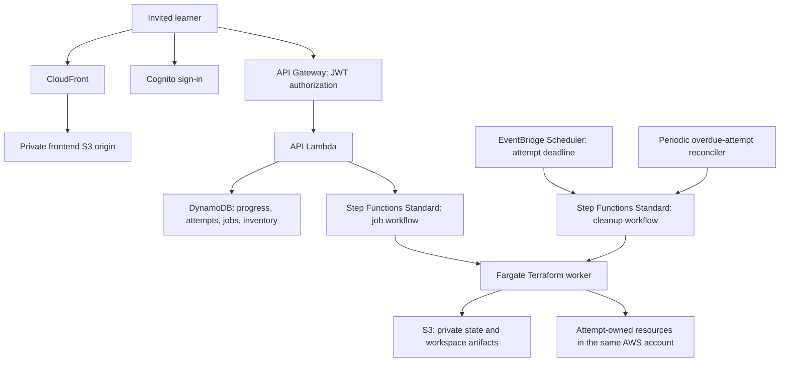

# AWS hosting and automatic lab cleanup

Proposed design, 16 November 2026. Audience confirmed by the user: **private/invite-only initially**. The platform and lab resources can share one AWS account with separate permissions and ownership namespaces. This document specifies a migration; the current Docker application remains the implemented runtime.

## Architecture

| Component | Proposed service and behavior |
| --- | --- |
| Frontend | Build the existing React/MDX application into a private S3 origin served by CloudFront using Origin Access Control. The login shell is accessible at the application URL; authenticated APIs control learner data and lab execution. Protect content at the edge too if lesson-asset confidentiality is required. |
| Identity | Cognito user pool, self-signup disabled, administrator invitations, authorization-code flow with PKCE and a browser app client without a client secret. |
| API | API Gateway HTTP API with a Cognito JWT authorizer and access-token scopes; Lambda handles short requests, grading-session operations and job submission. |
| Data | DynamoDB for learners, progress, exams, attempts, job receipts, execution leases and authoritative resource inventory. |
| Files/state | Separate private S3 buckets or tightly scoped prefixes for workspace revisions, reviewed plans, versioned Terraform state and sanitized artifacts. These are platform resources, excluded from lab cleanup. |
| Terraform execution | On-demand ECS Fargate tasks using the pinned Terraform/provider toolchain. Step Functions Standard orchestrates jobs and waits for task outcomes. |
| Expiry | One-time EventBridge Scheduler schedule per active attempt, targeting a cleanup Step Functions Standard workflow. A periodic overdue-attempt reconciler supplies a second recovery path. |
| Operations | CloudWatch logs/alarms, bounded retries, an SQS dead-letter queue for failed schedule delivery, cleanup-failure notifications and an operator recovery view. |



Lambda remains the API layer. The existing long-running subprocess worker should become a separate execution task rather than running inside an HTTP request. Ordinary Lambda event functions have a 15-minute maximum, while Terraform execution/recovery needs independent cancellation, durable state and retry control. Fargate also allows reuse of the existing container toolchain. [Lambda timeout](https://docs.aws.amazon.com/lambda/latest/dg/configuration-timeout.html), [Step Functions ECS/Fargate integration](https://docs.aws.amazon.com/step-functions/latest/dg/connect-ecs.html).

Host the regional control plane in one chosen region; Ireland is a reasonable initial option but is not yet a deployment decision. Labs continue to offer Ireland, N. Virginia and London. Domain 02 retains its fixed N. Virginia/London provider pair; IAM inventory remains account-global. CloudFront is global. A custom CloudFront hostname would require its certificate in us-east-1; the initial deployment can use the generated distribution hostname.

## Why TTL is not the lab timer

DynamoDB TTL emits a stream deletion event when DynamoDB actually deletes an expired item. AWS documents that deletion can occur days after the timestamp. A stream consumer could invoke cleanup, but this is unsuitable as the primary deadline mechanism and would remove the attempt record before cleanup succeeds. [DynamoDB TTL behavior](https://docs.aws.amazon.com/amazondynamodb/latest/developerguide/TTL.html).

Use two different timestamps:

- `expiresAt`: the application's absolute lab deadline, checked when accepting and dispatching jobs. Schedule cleanup against this value.
- `purgeAt`: an optional DynamoDB TTL attribute set only on disposable operational records after verified cleanup and a retention period. Do not put TTL on permanent course progress or erase the only resource inventory while cleanup is unresolved.

EventBridge Scheduler supports one-time invocations with 60-second precision when the flexible window is off. This starts the cleanup process near the deadline; it does not guarantee that all AWS deletions finish at that instant. Failed delivery and resource deletion require retries and monitoring. [Scheduler timing](https://docs.aws.amazon.com/scheduler/latest/UserGuide/schedule-types.html), [delivery dead-letter queues](https://docs.aws.amazon.com/scheduler/latest/UserGuide/configuring-schedule-dlq.html).

An alternative is a Standard Step Functions execution with a `Wait` until `expiresAt`. Scheduler is the proposed default because individual attempt deadlines can be inspected and updated without keeping a waiting workflow per lab. [Wait states](https://docs.aws.amazon.com/step-functions/latest/dg/state-wait.html).

## Attempt lifecycle

Proposed initial lease: two hours from lab start, configurable per lab, with explicit bounded extensions. Page views and polling do not renew it. Show the deadline/countdown and explain automatic teardown before launching a lab.

1. Derive the learner ID from the validated Cognito `sub`. Generate the attempt ID on the server and record its account, actual region scope, deadline, deadline version and workspace/state keys.
2. Install the one-time cleanup schedule before permitting resource creation, including SDK import-fixture setup. Store its identity durably. If scheduling fails, keep the attempt non-executable and retry or cancel it.
3. Accept a job only while the attempt is active, its deadline is in the future and no incompatible operation owns its execution lease. Return a job ID immediately.
4. The worker fetches the server-selected workspace revision and operation, rechecks the deadline/ownership, acquires the application lease and Terraform backend lock, then runs the approved command.
5. Store logs/results, plan/config hashes and inventory durably. Update trusted inventory as soon as identities are known and reconcile partial creations after interruption. Do not depend on the worker reaching a final success callback.
6. User teardown and expiry cleanup use the same idempotent deletion workflow. Extensions increment `deadlineVersion` and update the schedule; a stale event rereads the record and cannot delete an extended or already-cleaned attempt.

Creating/updating a DynamoDB record and a Scheduler schedule is not one transaction. Use a durable provisioning/outbox state and reconciliation, deterministic names/idempotency keys, and fail closed on unscheduled lab creation. Configure one-time schedules to delete themselves after completion. [CreateSchedule API](https://docs.aws.amazon.com/scheduler/latest/APIReference/API_CreateSchedule.html).

An attempt record should identify at least:

```text
learnerId, attemptId, domainId, awsAccountId, regions
status, expiresAt, deadlineVersion, scheduleId
workspaceRevision, configHash, planHash, stateLocation
activeJobId, workerTaskArn, leaseOwner, leaseVersion, heartbeatAt
cleanupStatus, cleanupAttempts, lastCleanupError, cleanupVerifiedAt
```

Store resource identities and receipt history separately so record size and retention do not erase recovery evidence. Grading/mastery records remain durable even after the lab environment expires.

## Cleanup workflow

The schedule carries the attempt ID and deadline version, not an arbitrary resource list supplied by a learner.

1. Read the authoritative attempt and conditionally claim cleanup. Duplicate delivery or a simultaneous manual destroy must converge on one cleanup owner. An extended deadline or verified-absent attempt becomes a no-op.
2. Mark the attempt closing and reject new writes/jobs. Cancel queued work, stop any running execution task and confirm it has stopped before taking over Terraform state. An expired application lease alone is not proof that its worker is dead.
3. Load the protected state/workspace and trusted inventory. Reconcile exact attempt-owned names/tags in the recorded regions and IAM's global scope to recover creations missed by the last callback.
4. Run Terraform destroy with credentials restricted to this attempt. If necessary, use the existing service-specific recovery adapters for owned leftovers, S3 object versions/delete markers and imported resources.
5. For domain 06, destroy workload resources, preserve/migrate its empty state while its temporary backend exists, then remove the temporary backend from its separate bootstrap state. Never delete the platform's state/artifact buckets as part of this exercise.
6. Directly verify absence. Only then mark infrastructure cleanup successful and remove it from the overdue-work index. Automatic expiry is recorded separately from learner completion, so cleanup alone does not award unperformed learning checks.
7. Retry transient/incomplete deletion with bounds. Keep failed attempts and inventory, alert an operator and expose the remaining owned resources. Set `purgeAt` only for records eligible for later deletion after the retention policy is met.

The periodic reconciler queries a sharded/bucketed due-time index for overdue, uncleaned attempts and restarts this same workflow. It covers missed schedules, delivery failures and a worker dying during creation. Avoid relying on a broad shared Project-tag deletion or on an empty Terraform state listing.

## Same-account permissions and isolation

The confirmed initial audience is invited learners. Cognito authentication still needs server-side ownership checks on every attempt, file, job, exam and progress request; a client-provided learner ID is not authoritative. [API Gateway JWT authorization](https://docs.aws.amazon.com/apigateway/latest/developerguide/http-api-jwt-authorizer.html).

Use separate platform API, orchestration, execution and cleanup identities. Learner execution gets only the service actions/resource scopes needed by its lab, with exact attempt ownership tags and resource-name constraints where supported. Explicitly protect platform S3, DynamoDB, Cognito, CloudFront, API Gateway, ECR and scheduling resources. Restrict PassRole/AssumeRole and IAM policy operations; tag matching alone is not a permission boundary.

Terraform HCL can execute commands and load arbitrary code. The task's own reachable IAM role must also be constrained: giving Terraform a restricted credential bundle is insufficient if the surrounding task exposes a more privileged role. The final IAM design must establish attempt scope for every reachable credential source. Cleanup must also be unable to delete another attempt or platform resources even if a learner poisons its own Terraform state.

Hosted users should not upload IAM keys or supply CLI profiles to run same-account labs. The platform uses execution roles and temporary credentials; retain profile/key onboarding for local mode. Enforce the deadline at API/worker dispatch and, where applicable, with date-limited learner session permissions. Cleanup receives fresh, separately authorized credentials that remain usable after the learner deadline. [IAM date/condition operators](https://docs.aws.amazon.com/IAM/latest/UserGuide/reference_policies_elements_condition_operators.html).

Set per-user/global execution concurrency and lab lifetime limits. Keep allowed resource types and resource counts, restrict modifications to the exact attempt and audit cleanup. These reduce exposure but are not an absolute billing cap. Opening public registration later requires revisiting isolation and abuse controls; separate platform/lab accounts would provide a stronger boundary then.

## Changes to the current implementation

- `runner/api/db.py` and direct SQL in exams/jobs/inventory need repository interfaces and a DynamoDB implementation. Preserve atomic answer submission, authoritative deadlines, immutable exam snapshots and job serialization with conditional writes/transactions.
- `runner/api/jobs.py` must replace the in-process thread pool, file lock and local working directory with durable dispatch, application leases and Fargate task identities.
- `runner/api/credentials.py` must provide hosted per-attempt execution credentials instead of one global local learner connection.
- `runner/api/main.py` needs Cognito-derived ownership and hosted-origin configuration. Its localhost-only guard cannot simply be deployed unchanged. Use status/log polling initially for asynchronous operations.
- Workspace editing/solutions and artifact retention need private S3 storage with server-validated keys, revisions and access checks. Preserve reviewed-plan/config hash binding; regenerate a plan after relevant edits.
- Reuse the lessons, exercises, question bank, Terraform templates, validator contracts and service-specific recovery logic. Adapt their persistence/identity dependencies rather than replacing actual Terraform labs with simulations.

## Migration and acceptance sequence

1. Introduce storage, identity and job-execution interfaces with the current local implementations still passing their existing tests.
2. Add Cognito invitation/login, private API authorization, DynamoDB learner/progress/exam records and S3 workspace/state storage. Test cross-user access denial and restart persistence.
3. Move one complete lab to the Fargate executor, preserving reviewed plans, logs, grading, state and direct cloud absence checks.
4. Implement scheduled expiry, manual teardown convergence, extensions, retries, dead-letter handling and overdue reconciliation. Test interruption during apply/destroy, expired worker credentials, missing tags/state associations and preservation of another learner's resources.
5. Port the other labs, including domain-06 backend ordering and domain-07 IAM/import identities. Verify all three supported lab regions and the fixed multi-provider pair. Exercise the complete invited-user browser journey before release.

Platform infrastructure should have its own IaC root and state, outside every learner workspace. Deployment configuration must cover the chosen account/region, invitation administrator, hostname choice, maximum concurrency, lab timeout and retention policy.

## Cost implications

The earlier lab-only usage estimate does not include hosting or worker execution. CloudFront/S3, APIs, data/log storage, identity and on-demand workers add their own usage. Fargate charges for task resources while they run. Networking also needs an explicit choice: short-lived tasks with public egress and closed inbound access versus private subnet NAT/endpoints. Avoid silently adding an always-on NAT gateway to a low-traffic course. Estimate the platform once concurrency and network choices are fixed. [Fargate pricing](https://aws.amazon.com/fargate/pricing/).

Timeout means denying further learner operations and initiating cleanup. AWS deletion latency, retries and failures mean it cannot be represented as a guaranteed instant resource deletion or spending cap.
